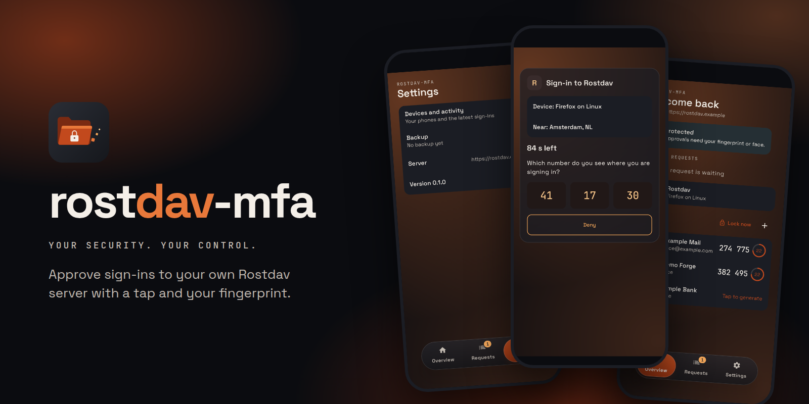
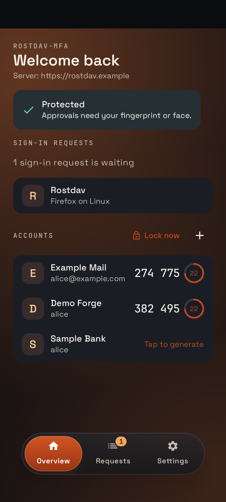
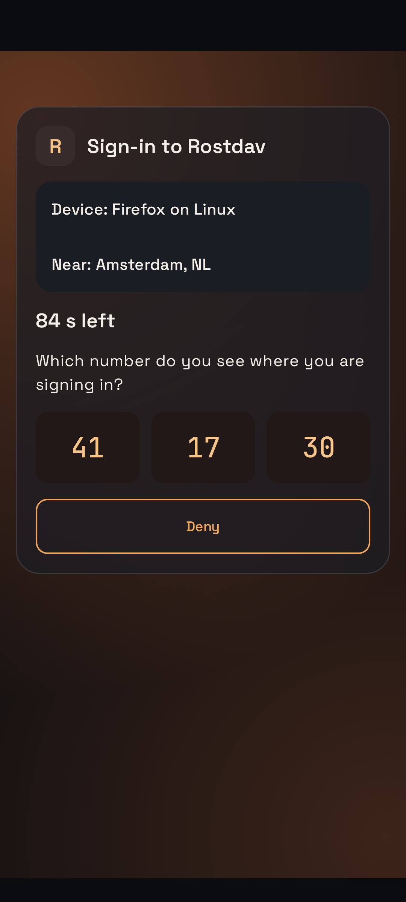
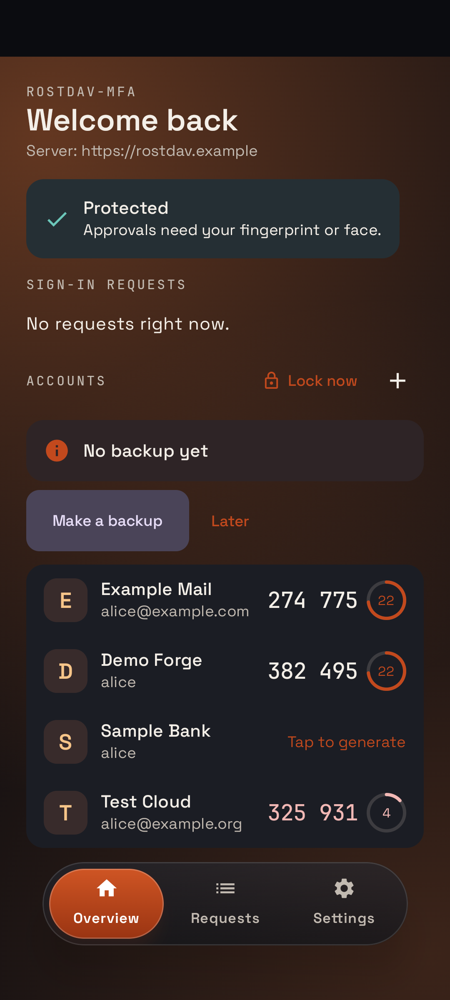
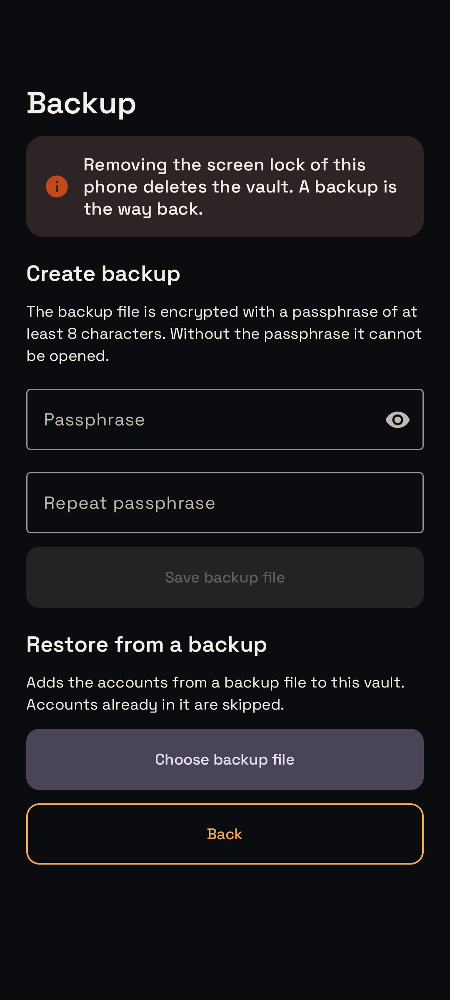
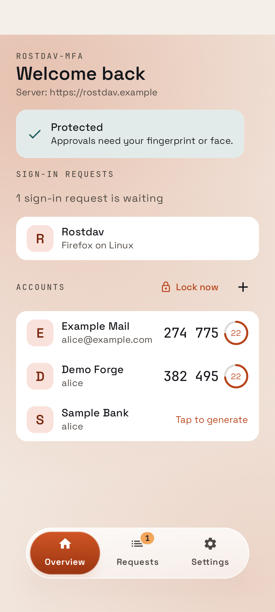
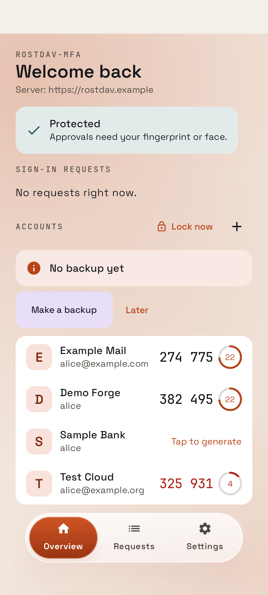
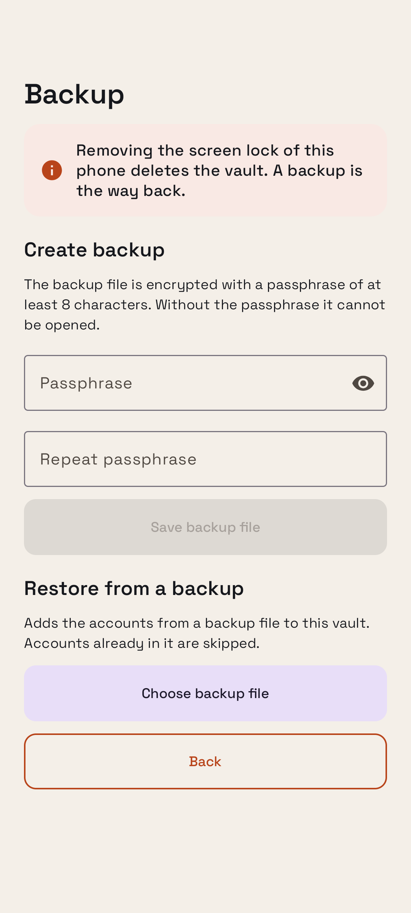

  <picture>
    <source media="(prefers-color-scheme: dark)" srcset="brand/logo/lockup-dark.svg">
    
  </picture>

<b>Your security. Your control.</b> Push approval for the sign-in of your own <a href="https://github.com/pierrejochem/rostdav">Rostdav</a> server, and your one-time codes on the phone.

rostdav-mfa is a self-hosted authenticator. When you sign in to Rostdav in a browser, your phone gets a request. You pick the number the browser shows (number matching), confirm with your fingerprint or face, and the browser signs in. The approval key lives in the phone's hardware-backed keystore and never leaves it. There is no account, no cloud service, and no third party in the loop; the default build needs no Google service at all.

The app also keeps the one-time codes (TOTP and HOTP) of your other accounts in an encrypted vault on the phone. You add an account by scanning its QR code or typing its secret key, unlock the vault with your fingerprint, face or PIN, and tap a code to copy it. A passphrase-encrypted backup file brings the accounts back on a new phone, or after the vault was lost because the screen lock was removed.

## What is here

| Folder | What it is |
| --- | --- |
| `android/` | The Android app (Kotlin, Jetpack Compose). See [`android/README.md`](android/README.md). |
| `contract/` | The shared signing contract (a Rust crate) with test vectors that the Rostdav server and the app both run. |
| `brand/` | Design tokens, logo kit, brand guide and store listing material. Tokens in `brand/tokens.json` generate the app's `Tokens.kt` and the site's `tokens.css`. |
| `media/` | Screenshots, light and dark: taken on an emulator against a real Rostdav, or rendered from the app's screens by tests where the window blocks capture (Approve and the vault). |

## Screenshots

| Overview | Approve | Accounts | Backup |
| --- | --- | --- | --- |
|  |  |  |  |
|  |  |  |  |

More screens, including Requests, Settings and adding an account, are in [`android/README.md`](android/README.md).

## Build and test

Use a JDK that is not GraalVM (Temurin 21 works), then:

    cd android
    ./gradlew :contract:test :vault:test :app:testNopushDebugUnitTest :app:lintNopushDebug :app:assembleNopushDebug

The brand tokens and their checks need only Python 3:

    python3 brand/generate.py --check
    python3 brand/check_contrast.py
    python3 -m unittest discover -s brand/tests

The emulator tests and the end-to-end run against a test Rostdav are described in [`android/docs/e2e.md`](android/docs/e2e.md).

## Status

Push approval, enrollment, devices, the new design and the authenticator vault (codes, add by scan or by hand, edit and delete, backup and restore, recovery of a vault that cannot be opened) are done and tested on an Android 15 emulator. Still open: the physical-phone checklist, Android 9 and 10, StrongBox hardware, UnifiedPush, and a store release. The vault has no search, sorting or folders, no service logos and no import from other authenticator apps. Clearing a copied code from the clipboard after 30 seconds works while the app is open; in the background Android may not allow it.

## Licence

Dual-licensed under the [Apache License 2.0](LICENSE-APACHE) or the [MIT licence](LICENSE-MIT), at your option. The bundled fonts, Space Grotesk and JetBrains Mono, are under the SIL Open Font License 1.1 (`android/app/licenses/`).
