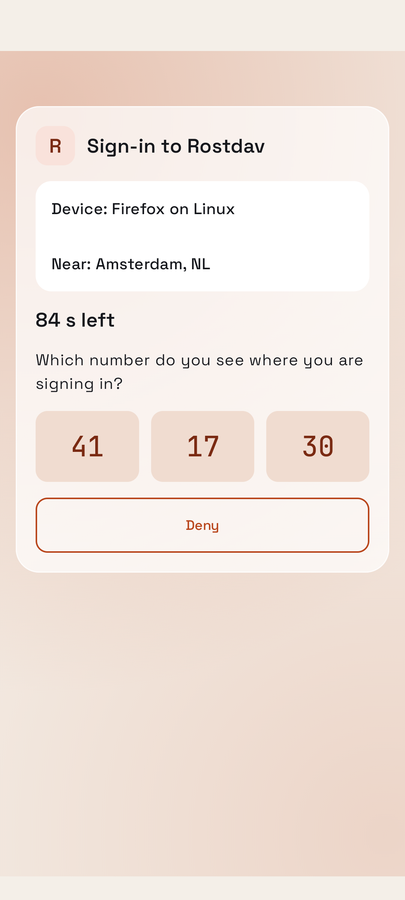

  <picture>
    <source media="(prefers-color-scheme: dark)" srcset="brand/logo/lockup-dark.svg">
    
  </picture>

<b>Your security. Your control.</b> Push approval for the sign-in of your own <a href="https://github.com/pierrejochem/rostdav">Rostdav</a> server.

rostdav-mfa is a self-hosted authenticator. When you sign in to Rostdav in a browser, your phone gets a request. You pick the number the browser shows (number matching), confirm with your fingerprint or face, and the browser signs in. The approval key lives in the phone's hardware-backed keystore and never leaves it. There is no account, no cloud service, and no third party in the loop; the default build needs no Google service at all.

## What is here

| Folder | What it is |
| --- | --- |
| `android/` | The Android app (Kotlin, Jetpack Compose). See [`android/README.md`](android/README.md). |
| `contract/` | The shared signing contract (a Rust crate) with test vectors that the Rostdav server and the app both run. |
| `brand/` | Design tokens, logo kit, brand guide and store listing material. Tokens in `brand/tokens.json` generate the app's `Tokens.kt` and the site's `tokens.css`. |
| `media/` | Screenshots taken on an emulator against a real Rostdav, light and dark. |

## Screenshots

| Overview | Approve | Requests | Settings |
| --- | --- | --- | --- |
|  |  |  |  |
|  |  |  |  |

## Build and test

Use a JDK that is not GraalVM (Temurin 21 works), then:

    cd android
    ./gradlew :contract:test :app:testNopushDebugUnitTest :app:lintNopushDebug :app:assembleNopushDebug

The brand tokens and their checks need only Python 3:

    python3 brand/generate.py --check
    python3 brand/check_contrast.py
    python3 -m unittest discover -s brand/tests

The emulator tests and the end-to-end run against a test Rostdav are described in [`android/docs/e2e.md`](android/docs/e2e.md).

## Status

Push approval, enrollment, devices and the new design are done and tested on an emulator. Still open: the physical-phone checklist, the authenticator vault (TOTP codes on the phone), UnifiedPush, and a store release. The vault shows up in the app as "planned" until it exists.

## Licence

Dual-licensed under the [Apache License 2.0](LICENSE-APACHE) or the [MIT licence](LICENSE-MIT), at your option. The bundled fonts, Space Grotesk and JetBrains Mono, are under the SIL Open Font License 1.1 (`android/app/licenses/`).
