# rostdav-mfa Android app

Native Android app for rostdav-mfa push approval (spec phases 2 to 4). The app talks to a Rostdav server over the contract in `../contract`.

## Screenshots

Pictures 01 to 03, 06 and 08 were taken on the emulator against a real Rostdav. The other screens block screen capture (`FLAG_SECURE`: Approve, the Overview while the vault is unlocked, and the add, backup and restore screens), so their pictures are rendered from the real composables with sample data: Approve by `ScreenshotsTest`, the vault screens and Settings by `VaultScreenshotsTest`. The vault pictures use made-up services and public test secrets. `VaultScreenshotsTest` is opt-in (it is skipped unless the instrumentation argument `screenshots` is `true`); its class comment has the commands.

| Screen | Dark | Light |
| --- | --- | --- |
| Connect to your server | 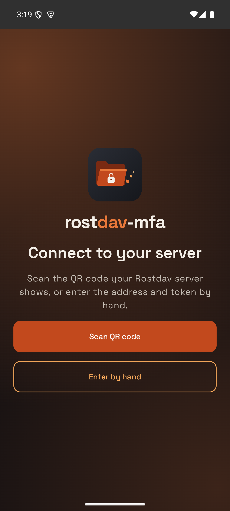 | 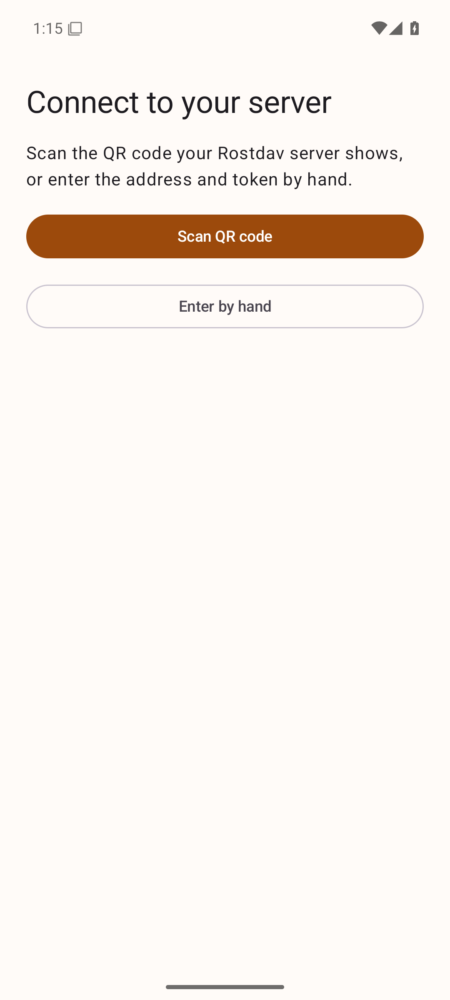 |
| Enter by hand | 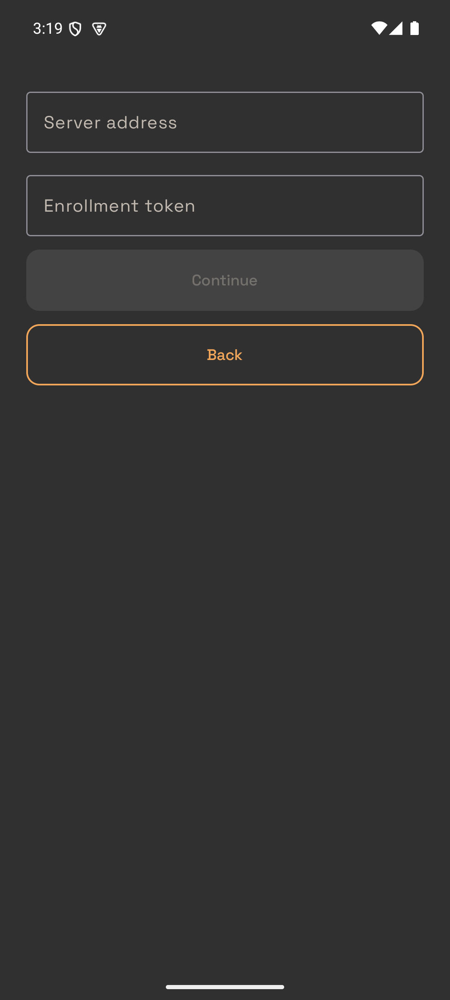 | 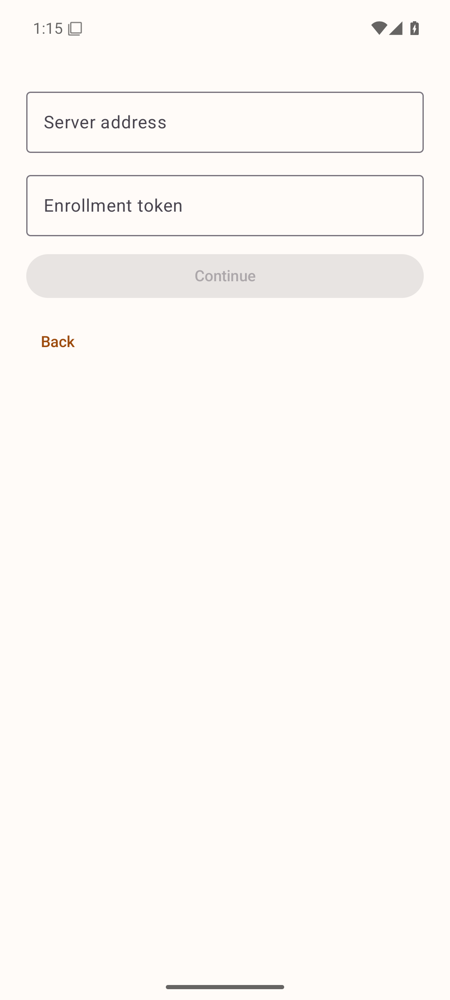 |
| Name this phone | 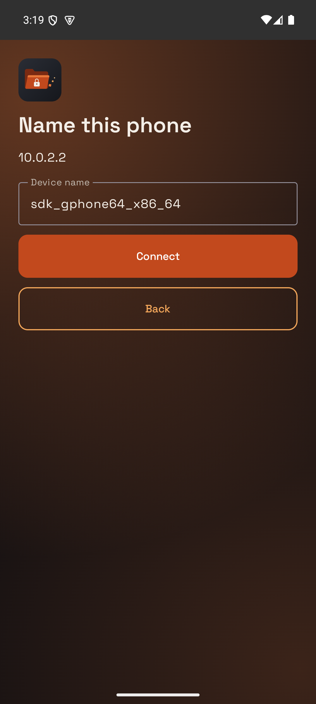 | 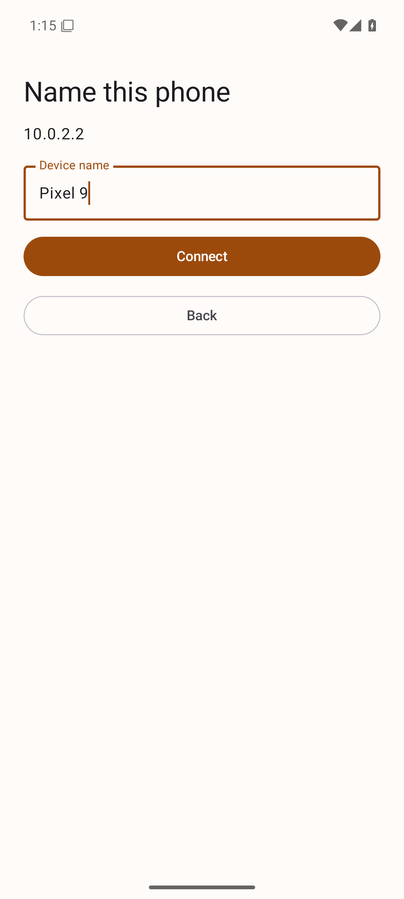 |
| Overview, no requests, vault locked | 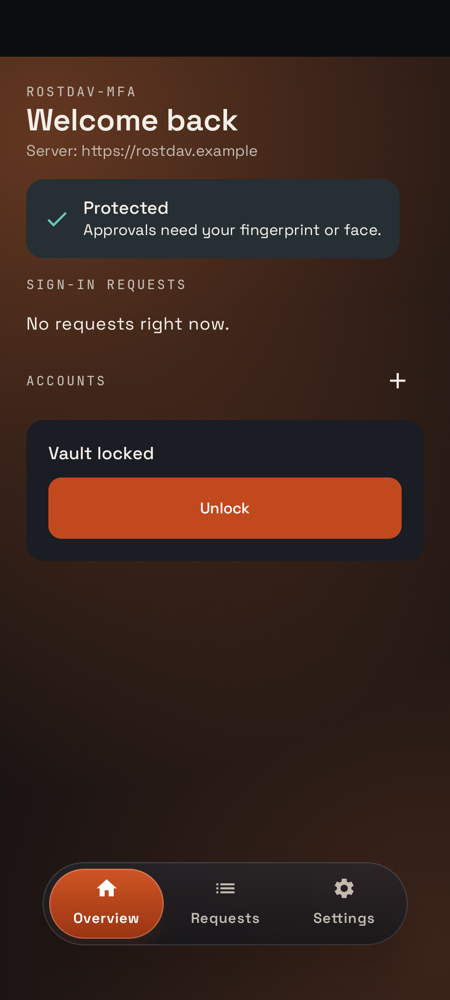 |  |
| Overview with a request and accounts | 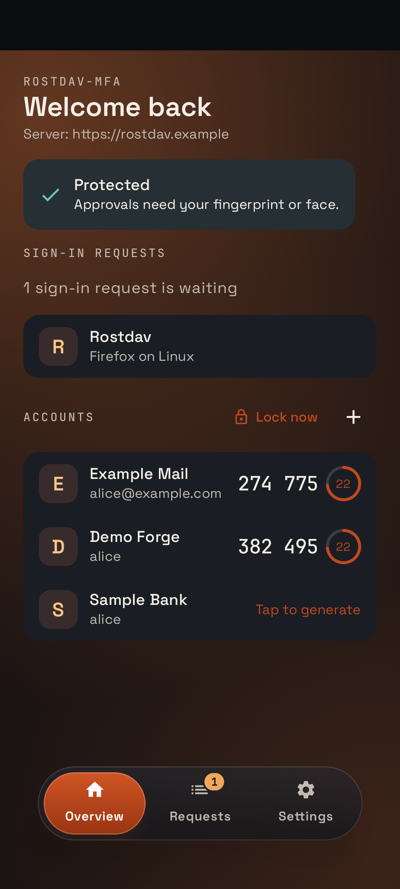 |  |
| Requests | 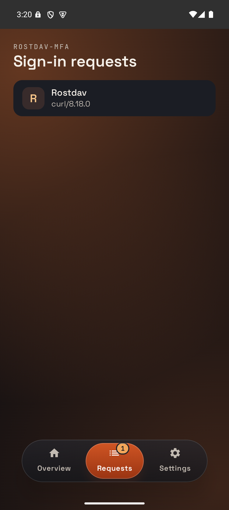 | 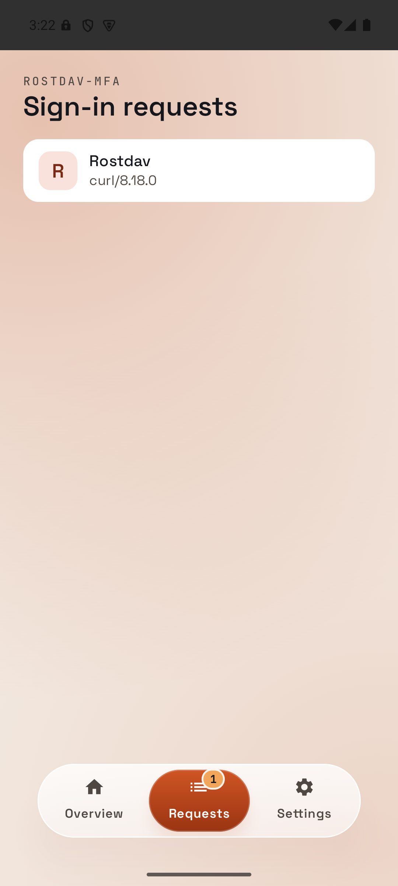 |
| Settings | 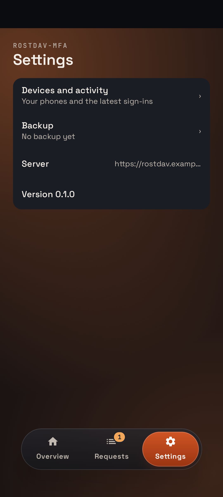 | 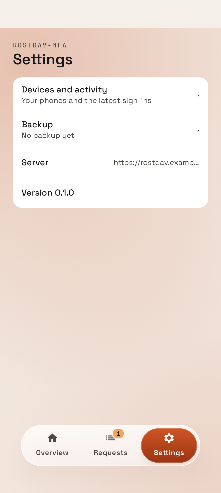 |
| Devices | 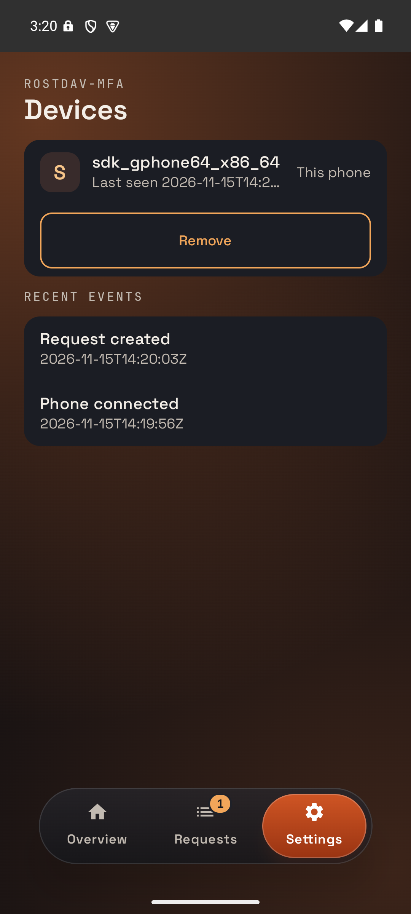 | 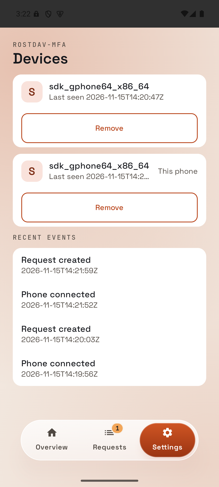 |
| Approve | 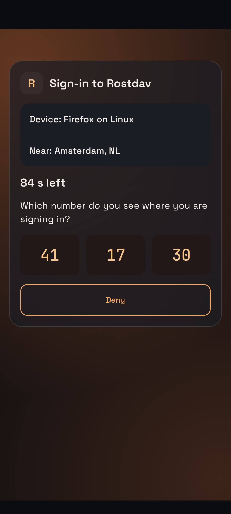 |  |
| Approved | 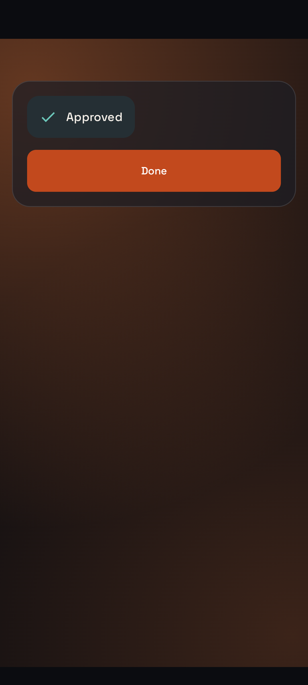 | 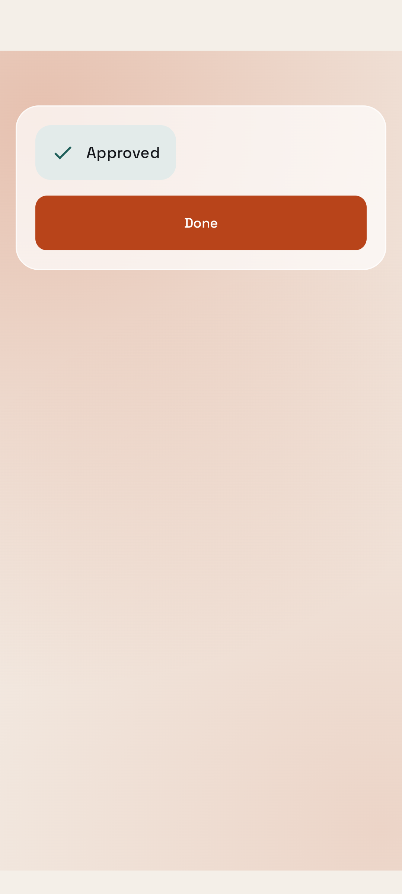 |
| Accounts with live codes and the backup reminder | 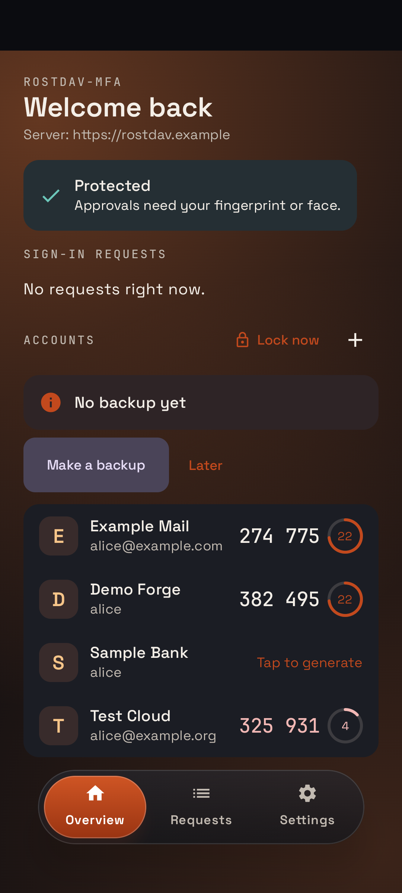 |  |
| Add account: check the names and the first code | 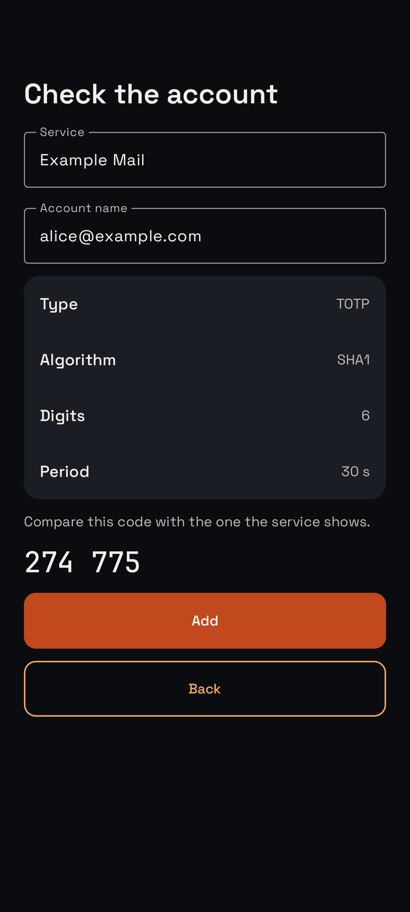 | 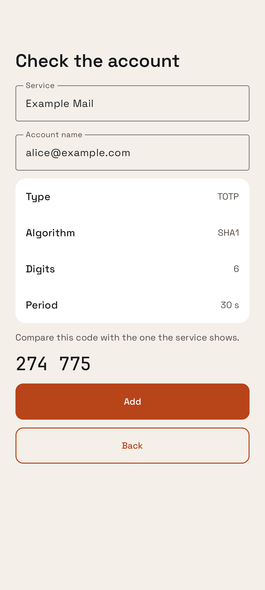 |
| Backup |  | 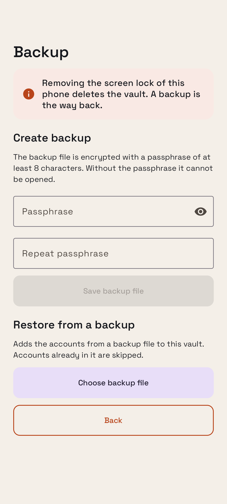 |

## Modules

- `:contract` is a plain JVM module with the byte-exact logic (canonical strings, request signing, signature encoding). Its tests read the shared vectors `../contract/vectors/v1.json`, the same file the Rust tests use.
- `:vault` is the vault core, a plain JVM module: TOTP and HOTP, otpauth URIs, the encrypted seed store, the unlocked session with auto-lock and the passphrase-encrypted backup. Argon2id comes from Bouncy Castle. `docs/vault.md` has the formats, the rules and the screens.
- `:app` is the Android application, package `app.rustmfa.android`, with the flavors `nopush` (default) and `fcm`. The vault screens are in `ui/vault`, the view models and Android parts of the vault in `vault`.

## Build

Use a JDK that is not GraalVM. The `jlink` of GraalVM CE fails inside the Android Gradle plugin with `Module jdk.internal.vm.ci not found`. Temurin 21 works:

    export JAVA_HOME=$HOME/.sdkman/candidates/java/21.0.13.0+9-tem
    cd android
    ./gradlew :contract:test
    ./gradlew :app:assembleNopushDebug

`local.properties` (git-ignored) must set `sdk.dir`.

## Test

    ./gradlew :contract:test :vault:test :app:testNopushDebugUnitTest :app:lintNopushDebug

The emulator tests need a running device (the debug build allows cleartext HTTP for the test server):

    ./gradlew :app:connectedNopushDebugAndroidTest

An emulator that restarted asks for its PIN again; until it is unlocked, instrumentation fails with "not encryption aware".

## Run on the emulator against a Rostdav

`docs/e2e.md` has the server configuration (`attestation = "off"`, `public_url = "http://10.0.2.2:<port>"`), the commands and the results of the run, and the checklist for a physical phone.

Continuous integration (`../.github/workflows/android.yml`) runs the unit tests, lint, the `nopush` build and the contract tests of both languages on every push. It does not run the emulator tests.

## Push

The default `nopush` build needs no Google file and no Google service. It registers with the channel `none` and an empty token, and finds new requests by polling while the app is open (every 15 seconds, every 3 seconds while a login is awaited). Notifications are posted for requests the poller sees.

The `fcm` flavor adds Firebase Cloud Messaging. It builds only against your own Firebase project: put its `google-services.json` in `android/app/` (the file is git-ignored and never committed), then run `./gradlew :app:assembleFcmDebug`. A push carries only a challenge id; the phone fetches the details through the signed request. If the phone gets no token, it registers with `none` and polls.

## Versions

Chosen from the registries on 2026-11-10: Gradle 9.9.1, Android Gradle plugin 9.5.1, Kotlin 2.4.21, Compose BOM 2026.09.00, compileSdk and targetSdk 37, JVM target 17.
