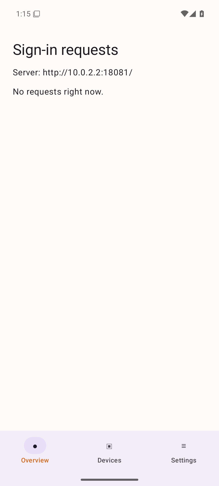
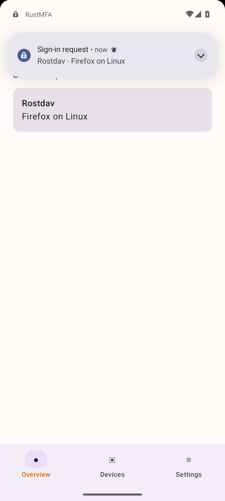
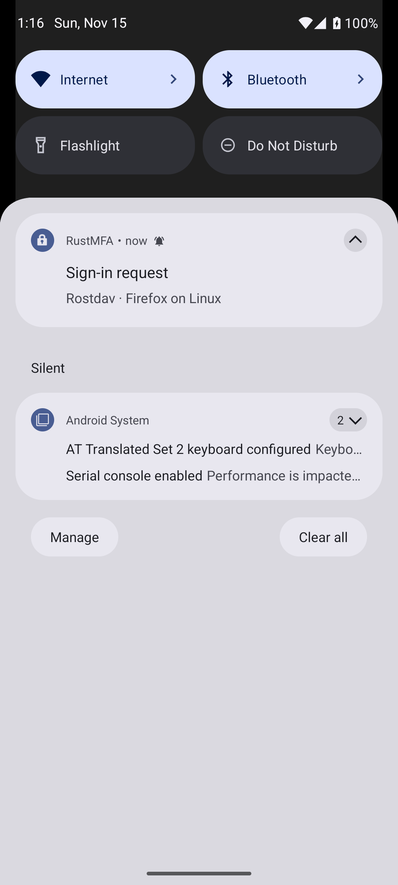
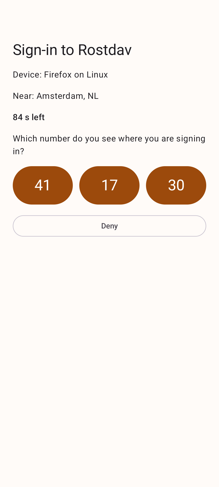
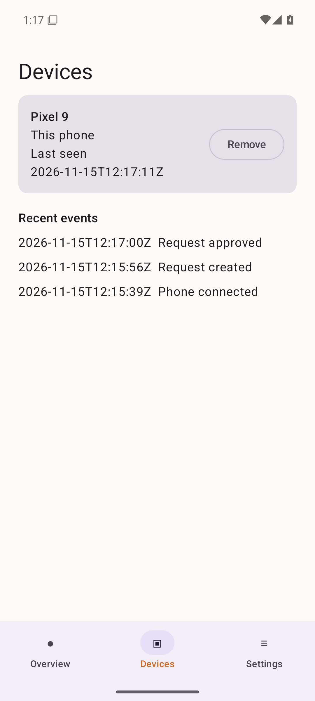
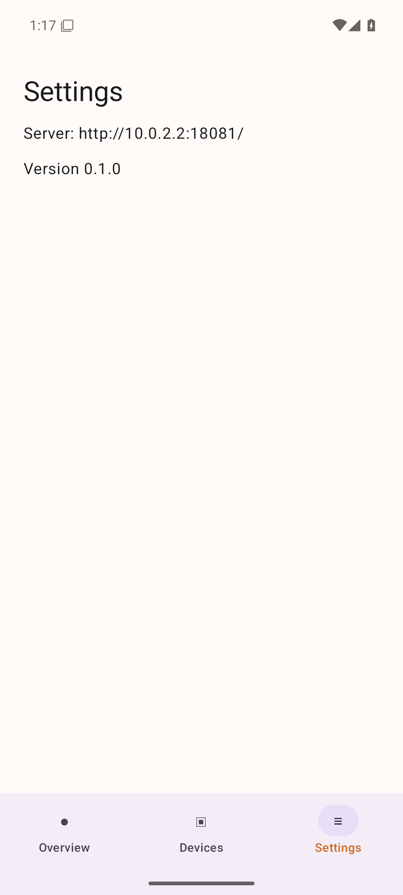
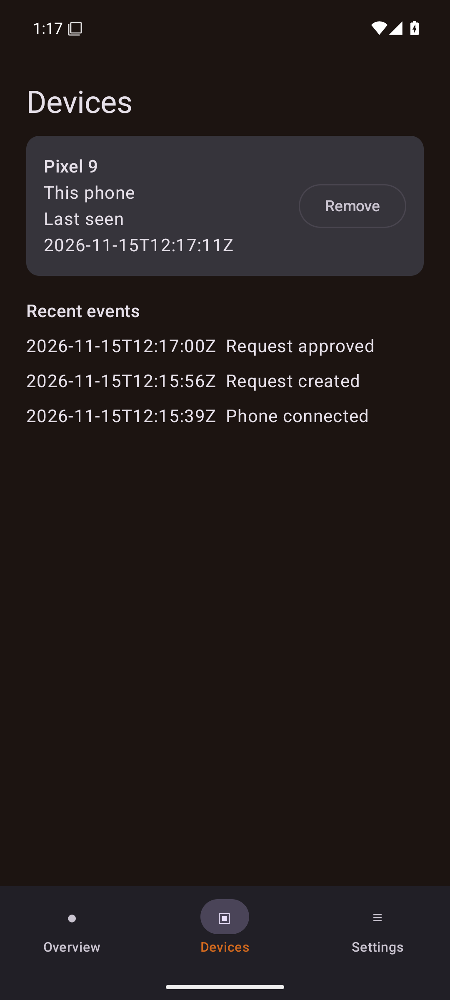
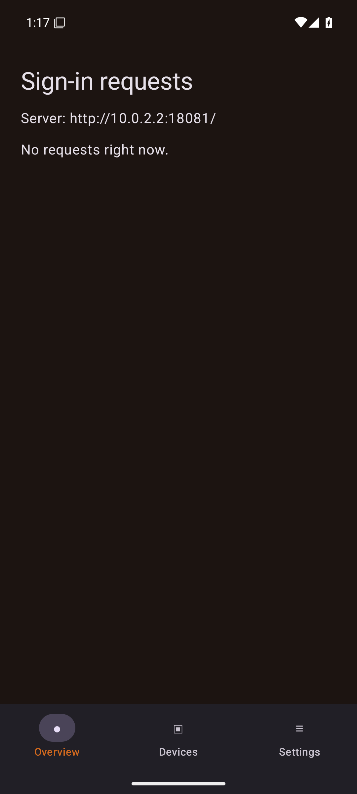
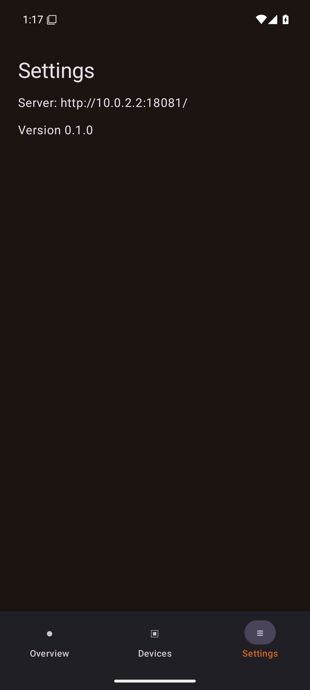

# RustMFA Android app

Native Android app for RustMFA push approval (spec phases 2 to 4). The app talks to a Rostdav server over the contract in `../contract`.

## Screenshots

Taken on the emulator against a real Rostdav (light first, then dark). The Approve screen blocks screen capture (`FLAG_SECURE`), so its pictures are rendered by `ScreenshotsTest` instead of captured from the window.

| | | |
| --- | --- | --- |
|  |  |  |
|  |  |  |
|  |  |  |
|  |  |  |
|  |  | |

## Modules

- `:contract` is a plain JVM module with the byte-exact logic (canonical strings, request signing, signature encoding). Its tests read the shared vectors `../contract/vectors/v1.json`, the same file the Rust tests use.
- `:app` is the Android application, package `app.rustmfa.android`, with the flavors `nopush` (default) and `fcm`.

## Build

Use a JDK that is not GraalVM. The `jlink` of GraalVM CE fails inside the Android Gradle plugin with `Module jdk.internal.vm.ci not found`. Temurin 21 works:

    export JAVA_HOME=$HOME/.sdkman/candidates/java/21.0.13.0+9-tem
    cd android
    ./gradlew :contract:test
    ./gradlew :app:assembleNopushDebug

`local.properties` (git-ignored) must set `sdk.dir`.

## Test

    ./gradlew :contract:test :app:testNopushDebugUnitTest :app:lintNopushDebug

The emulator tests need a running device (the debug build allows cleartext HTTP for the test server):

    ./gradlew :app:connectedNopushDebugAndroidTest

An emulator that restarted asks for its PIN again; until it is unlocked, instrumentation fails with "not encryption aware".

## Run on the emulator against a Rostdav

`docs/e2e.md` has the server configuration (`attestation = "off"`, `public_url = "http://10.0.2.2:<port>"`), the commands and the results of the run, and the checklist for a physical phone.

Continuous integration (`../.github/workflows/android.yml`) runs the unit tests, lint, the `nopush` build and the contract tests of both languages on every push. It does not run the emulator tests.

## Push

The default `nopush` build needs no Google file and no Google service. It registers with the channel `none` and an empty token, and finds new requests by polling while the app is open (every 15 seconds, every 3 seconds while a login is awaited). Notifications are posted for requests the poller sees.

The `fcm` flavor adds Firebase Cloud Messaging. It builds only against your own Firebase project: put its `google-services.json` in `android/app/` (the file is git-ignored and never committed), then run `./gradlew :app:assembleFcmDebug`. A push carries only a challenge id; the phone fetches the details through the signed request. If the phone gets no token, it registers with `none` and polls.

## Versions

Chosen from the registries on 2026-11-10: Gradle 9.9.1, Android Gradle plugin 9.5.1, Kotlin 2.4.21, Compose BOM 2026.09.00, compileSdk and targetSdk 37, JVM target 17.
